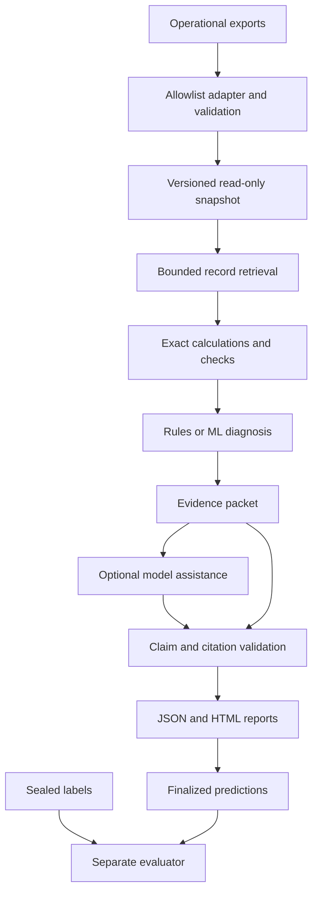

# Reconcile: Full Build Plan

**Updated:** 1 November 2026  
**Status:** Implementation plan; no application, benchmark results, customer savings, or external adoption have been achieved.  
**First release:** A read-only, evidence-backed accounts-payable-to-bank exception investigator with evaluation built in.

This plan replaces the earlier PDF-matching and approval application. Establish measurable investigation quality before expanding into a full application.

## 1. Outcome and first-release scope

A finance operations analyst sees a payment that does not reconcile. Reconcile gathers the related operational records, checks amounts and chronology, and returns a supported diagnosis or identifies what remains unknown.

The first demonstrable result is **more correct, fully evidenced investigations than a strong baseline on the same unseen cases, at a measured cost**. Features and attractive explanations alone are not evidence of business value.

| Initial family | Benchmark mapping | Required distinction |
|---|---|---|
| Suspected duplicate payment | F06: invoice paid twice | Two committed payments versus instalments, reversals, or repeated source ingestion |
| Missing settlement | F12: ERP payment missing from bank | Actionable missing settlement versus an ordinary clearing delay |
| Amount discrepancy | F14: bank/ERP amount mismatch | Unsupported difference versus a documented fee or adjustment |

Verify these mappings against the pinned [FinRCA taxonomy](https://github.com/PratikGhawate/FinRCA-AI-Bench/blob/main/docs/failure_taxonomy.md) during the data audit. Other failure classes remain in an out-of-scope challenge evaluation; inability to diagnose them must not become a legitimate/no-failure conclusion.

**Version 0.1 includes:** one structured-data contract and FinRCA adapter; exact financial checks; bounded retrieval; diagnosis or abstention; cited evidence and calculations; proposed next actions; Python library, CLI, batch runner and static JSON/HTML reports; strong baselines and embedded evaluation; optional model assistance whose contribution is measured.

**Deferred:** PDF/OCR ingestion, hosted UI, authentication and multi-user tenancy, live banks, ERP write-back, approvals, payment execution, streaming infrastructure, Kubernetes, general agent orchestration, and a separate finguard product.

Process one organization snapshot per local run. Do not advertise hosted multi-tenant security. The other five projects are independent and are not prerequisites.

## 2. Evidence and dataset strategy

Use [FinRCA-Bench](https://github.com/PratikGhawate/FinRCA-AI-Bench) as the primary independent synthetic benchmark. Its [paper](https://arxiv.org/abs/2608.18534) reports stronger classical-ML classification than its evaluated graph-assisted LLM configuration. Predicting a category and assembling complete supporting evidence must therefore be evaluated separately.

| Source | Role | Limitation |
|---|---|---|
| FinRCA | First investigation evaluation | Audit labels, visible information and evaluator before accepting results |
| [RecBench](https://huggingface.co/datasets/end-close/recbench) | Later matching/exception transfer task | Matching truth is not root-cause truth |
| [FinBalance](https://github.com/Devansh1105/finbalance) | Later document-grounding task | Different accounting task; documented expert review does not establish production transfer |
| [BenchRec](https://www.operartis.com/benchrec) | Possible later production-derived comparison | Access requires a request; download and reuse rights remain unconfirmed |

The debate verified selected public records, not entire dataset correctness. Start the audit from FinRCA revision `76c93ec32536e29826e2ab9e68b58e0351410bc7`, recorded during that research. Verify the revision and licence again before use; explicitly record any revision change.

### Acquisition and provenance

- Store unmodified upstream files in ignored `data/upstream/`.
- Record URL, revision, retrieval date, licence, file hashes, sizes and row counts in a dataset manifest.
- Inspect upstream dependencies and execution instructions before running them in an isolated environment.
- Preserve upstream notices and document separately the rights for code, data, fixtures and model outputs.
- Start with the primary dataset and small development fixtures; defer large secondary downloads.
- Use our own tiny synthetic fixtures for tests and smoke demonstrations, not headline performance claims.

### Input and label separation

| Zone | Contents | Readers |
|---|---|---|
| Operational inputs | Allowlisted records and neutral investigation requests | Baseline/investigator processes |
| Development labels | Training and validation labels under the declared protocol | Training/evaluation tooling |
| Sealed labels | Test/challenge answers and scoring provenance | Evaluator after predictions are finalized |

For sealed evaluation, run inference with only prepared operational inputs mounted. Do not give it the upstream checkout, evaluator files or label directory. A module import convention alone is insufficient isolation.

- Define explicit allowed columns from the upstream [schema](https://github.com/PratikGhawate/FinRCA-AI-Bench/blob/main/docs/schema.md); a denylist alone is insufficient.
- Withhold expected answers/resolutions, truth files, failure manifests, mutation logs and generator causal edges.
- Do not use oracle-selected case evidence packages in the headline retrieval experiment: finding the records is part of the task.
- Build neutral requests from observable entity identifiers and symptoms. Audit question wording, IDs, filenames, descriptions and operational audit records for class-encoding artifacts.
- Distinguish event time from observation time. Exclude information unavailable at the cutoff. If availability timestamps are absent, document the snapshot assumption and do not claim historically faithful replay.
- Preserve vendor-group separation. Multiple question variants for one case are correlated observations, not extra independent cases.
- Track which cases and labels were inspected during reproduction. The original published test set may serve as a reproduction set; it cannot also be called untouched if inspected. Reserve the challenge set before development, or create a separately declared vendor-held-out generated set if that challenge data has already been inspected. Keep this final holdout out of M0 case audits and iterative comparisons.
- Inspect entities bridging splits; restrict model learning to training data and document the operational snapshot available at inference.

### Practitioner and real-format evidence

FinRCA can establish technical value only. A tool that finance teams rely on also needs evidence that it fits their data, their exceptions and their decisions. Collect this alongside the benchmark from M0, not after release.

| Source | Purpose | Limitation |
|---|---|---|
| Practitioners (AP clerks, finance operations leads, controllers) | Confirm which exceptions are frequent and costly, what a correct next step is, and what a report must show to be trusted | Small, non-random sample; self-reported time and cost are estimates, not measurements |
| Published export formats | Design the input contract against real accounting exports and bank statements, not only FinRCA's layout | Specifications and sample files do not show real-world data quality |
| Realistic-shape fixtures | Exercise messy references, partial payments, batched settlements, netted fees and reversals | Our own construction; tests robustness, not prevalence |
| Anonymised practitioner exports, if offered | Check the contract and checks against genuine data | Only with written permission; never a headline benchmark |

Candidate formats, to be prioritised from practitioner input: accounting exports from Xero, QuickBooks Online, NetSuite, Sage or SAP; bank statements as CSV, ISO 20022 CAMT.053, SWIFT MT940 and BAI2.

Handling rules:

- Real exports contain supplier bank details, personal data and commercially sensitive amounts. Store them only in ignored `data/private/`, never in fixtures, tests, issues, logs or model prompts.
- Use them only under written permission recording the permitted purpose, retention period and deletion.
- Publish only aggregate, permission-cleared findings. Keep practitioner statements separate from benchmark results and label them as self-reported.
- Record who was consulted by role and experience, not by name, unless they agree to be credited.

## 3. Architecture and technology

Implement explicit bounded stages. A general agent framework is not needed for the initial workflow.



These are proposed choices, not installed dependencies. Pin exact versions after compatibility checks in M1.

| Concern | Initial choice | Purpose |
|---|---|---|
| Runtime/package management | Python 3.11+, `pyproject.toml`, `uv` lockfile | Reproducible application; isolate upstream baseline dependencies where needed |
| Contracts | Pydantic and versioned JSON schemas | Strict validation and inspectable artifacts |
| Money | `Decimal`, string serialization, explicit currency/scale | Avoid float discrepancies and implicit conversion |
| Operational store | Indexed SQLite snapshots | Local relational retrieval without an external service |
| Checks/features | SQL and typed Python | Explainable financial checks |
| Classical ML | Reproduce upstream first; compatible scikit-learn tooling where applicable | Preserve faithful comparison |
| CLI/reporting | Typer, Jinja2 with escaping | Local usability and standalone HTML |
| Model access | One provider behind a small interface | Keep domain logic independent of provider SDKs |
| Quality | pytest, targeted property tests, Ruff, type checking | Verify meaningful financial and evaluation invariants |
| Packaging | Wheel and reproducible container | Library reuse and isolated execution |

Do not add a vector database initially. Follow observable financial relationships, using bounded candidate search where references are missing. Semantic retrieval needs a measured justification.

| Module | Responsibility | Boundary |
|---|---|---|
| `adapters/` | Normalize operational sources | No evaluator label access |
| `domain/` | Money, identities, findings, packets | No provider SDK imports |
| `store/` | Build/query versioned snapshots | Read-only during inference |
| `retrieval/` | Linked/candidate records | Explicit hop, row and time budgets |
| `checks/` | Arithmetic, chronology, settlement/allocation checks | No generated financial calculations |
| `diagnosis/` | Rules/ML predictions, evidence, abstention | No operational writes |
| `models/` | Structured optional model calls | No arbitrary SQL, shell or payment tools |
| `reports/` | JSON/HTML rendering | Escaped text; no runtime network assets |
| `runs/` | Manifests, durable results, retries, costs | Atomic artifact finalization |
| `evaluation/` | Score persisted predictions | Never imported by investigator code |

## 4. Domain contracts and invariants

Export a `schema_version` on persisted artifacts and reject unsupported versions clearly.

| Contract | Minimum fields |
|---|---|
| `DatasetManifest` | Source revision, file digests, licence reference, adapter version, counts, config digest |
| `RecordRef` | Snapshot, organization, table, source ID, source-file digest, optional row locator |
| `Money` | Decimal amount string, currency, scale/rounding policy |
| `InvestigationRequest` | Request ID, snapshot, primary entity, neutral symptom, cutoff, policy version |
| `EvidenceItem` | Record reference, allowed values, retrieval relationship, available timestamps |
| `Calculation` | Operation, referenced operands, currency, rounding, result, tolerance rule |
| `Finding` | Check ID, supported/contradicted/unknown state, evidence/calculation references |
| `Diagnosis` | Primary category, disposition, findings, alternatives, missing information |
| `Recommendation` | Proposed action type, prerequisites, supporting findings, unresolved assumptions |
| `EvidencePacket` | Request, diagnosis, evidence, calculations, actions, limitations, provenance |
| `RunManifest` | Code/config/data digests, model/prompt IDs, seeds, environment, usage, timing, status |

Use dispositions `answered`, `abstained`, `out_of_scope`, and `failed`. Separate execution status from diagnosis category. `legitimate` is a supported financial conclusion, not a fallback for unsuccessful investigation.

Qualify IDs by organization, table and snapshot. Identical identifiers across systems do not prove a relationship.

Financial and evidence invariants:

- Do not combine currencies without a documented conversion path; abstain on unsupported FX cases in v0.1.
- Fee tolerances must be explicit and supported. Similar amounts alone do not prove a match.
- Distinguish reversals, instalments and duplicate committed payments.
- Deduplicate identical source imports by identity/content, not by amount/date. Preserve distinct payments that happen to look identical.
- Conflicting rows with one source key are ingestion errors; missing counterparts may be the exception and must remain visible.
- Every accepted citation resolves in the allowed snapshot under the cutoff policy.
- Recompute every reported monetary result deterministically.
- Mark retrieval truncation and budget exhaustion as incomplete evidence.
- Recommendations never execute financial actions; a missing settlement must not become an unconditional instruction to pay again.
- Local hashes support reproducibility and tamper detection relative to a trusted manifest. Do not call ordinary local files an immutable audit system.

## 5. Target repository layout

This is a build target, not a list of files that already exist.

```text
reconcile/
  README.md, SCOPE.md, PLAN.md
  pyproject.toml, uv.lock, Dockerfile
  LICENSE, DATA_SOURCES.md, CONTRIBUTING.md, SECURITY.md
  configs/
    development.yaml, evaluation.yaml, policies.yaml
  src/reconcile/
    adapters/       # base contract, FinRCA, generic CSV bundle
    domain/         # money, records, requests, evidence, diagnosis
    store/          # snapshot preparation and queries
    retrieval/      # relationships, candidates, budgets
    checks/         # duplicate, settlement, amount checks
    diagnosis/      # rules, classical ML, abstention, pipeline
    models/         # base interface, fixture, provider, validation
    reports/        # JSON and HTML
    runs/           # manifests, runner, cache
    cli.py
  evaluation/
    adapters/finrca_labels.py
    baselines/, metrics/
    compare.py, protocol.yaml
  tests/
    unit/, integration/, leakage/, regression/
  fixtures/public/
  data/             # ignored upstream/input/label data; private/ for permitted practitioner exports
  artifacts/        # ignored runs; select reviewed release artifacts explicitly
  docs/
    architecture.md, data-audit.md, baseline-reproduction.md
    evaluation-protocol.md, results-card.md, failure-analysis.md
    practitioner-findings.md, export-formats.md
    decisions/
  .github/workflows/
    ci.yml, benchmark.yml
```

## 6. Milestones, tasks and decision gates

Complete M0–M3 before investing in model orchestration or interface polish. Each milestone must leave inspectable artifacts.

### M0 — Verify the evidence path

- [ ] Pin source revision, inspect licences, and record the dataset manifest.
- [ ] Inspect actual schemas, taxonomy, evaluator definitions and baseline entry points.
- [ ] Map the three families and relevant legitimate cases to observable inputs and scoring labels.
- [ ] Audit ten training cases per initial family and at least ten legitimate cases by tracing records to conclusions. Label this an engineering audit, not expert financial adjudication.
- [ ] Record ambiguous or unobservable labels; do not invent missing support.
- [ ] Check splits, repeated-question grouping, temporal assumptions and leakage.
- [ ] Reproduce published SQL and classical-ML experiments in isolation, retaining exact commands, environment and predictions.
- [ ] Separate faithful published-task reproduction from the operational comparison. If upstream inputs contain privileged features or oracle evidence, keep that experiment diagnostic and build an observable-input counterpart.
- [ ] Recruit at least two practitioners from different organisations or roles, and record the permitted use of anything they share.
- [ ] Ask them which AP-to-bank exceptions are most frequent and costly, how each is investigated today, what the correct next step is, and what evidence they need before acting.
- [ ] Record their estimates of investigation time per exception type and the typical cost of a missed duplicate or unresolved settlement, labelled as self-reported.
- [ ] Shortlist one accounting export and one bank statement format to support first, based on what practitioners use; record field lists and sample-file sources.

**Deliverables:** `docs/data-audit.md`, `DATA_SOURCES.md`, `docs/baseline-reproduction.md`, `docs/practitioner-findings.md`, `docs/export-formats.md`, manifest and executable baseline instructions.

**Gate:** A trustworthy comparison and scoreable evidence contract exist. Investigate unexplained reproduction differences before claiming superiority. If the data cannot support an honest experiment, stop and reassess before building around it. If practitioners do not confirm the three families as worth investigating, revise the families before M1 rather than building for the benchmark alone.

**Gate outcome (2026-11-01): conditional pass, approved by the user, with the direction "repair FinRCA".** Evidence: `DATA_SOURCES.md`, `docs/data-audit.md`, `docs/baseline-reproduction.md`, `docs/export-formats.md`, `docs/practitioner-findings.md`, and three Codex review rounds (14 findings, all fixed).
- **Why it is conditional:** the gate test isn't fully met. FinRCA leaks class through its inputs (data audit L1–L12), and its published evidence for F12, F14 and pending cases relies on excluded events. The section 3.1 allowlist is a design, not yet tested. No practitioner has been interviewed.
- **What M0 showed about the baselines:** they reproduce exactly. On the leaky published inputs, the classical-ML baseline already identifies all 49 three-family test cases, with 4 false alarms, but returns no evidence; Rules/SQL evidence is complete for only 13% of its correct answers. The useful comparison is therefore evidence-complete diagnosis from observable inputs.
- **Carried into M1:** the first three M1 tasks below. One residual signal remains open: `gl_entries` FX-settlement codes. Practitioner interviews continue in parallel and can still revise the families before M2.

### M1 — Contracts, ingestion and input isolation

- [ ] Implement the `docs/data-audit.md` section 3.1 input transform in the FinRCA adapter: enumerated columns only, opaque remapping with shared reference namespaces, dropped tables and columns, the section 6 cutoff rule, and rows re-sorted. Preparing the same inputs twice must give the same snapshot digest.
- [ ] Leakage test on the transformed training data: from the allowed fields, a simple classifier must not beat the base rate at recovering inserted rows, row or ID order, or family. Record the results; any residual signal is a finding.
- [ ] Define our own evidence contract for F06, F12, F14 and the payment-related legitimate cases, using observable inputs only (`docs/evidence-contract.md`). Validate it on train and validation, and record the cases it cannot grade (e.g. RCA_000588).
- [ ] Initialize the package, lock dependencies, and configure formatting, typing and tests.
- [ ] Implement versioned domain schemas and strict validation.
- [ ] Implement the allowlisted FinRCA adapter and neutral request preparation.
- [ ] Build an indexed SQLite snapshot and ingestion-quality report.
- [ ] Implement money parsing, currency scale, timestamps and cutoff policy.
- [ ] Preserve missing relationships as findings; reject malformed/conflicting identities visibly.
- [ ] Implement idempotent imports without removing genuine duplicate-payment records.
- [ ] Separate inference/evaluator paths and restricted inference mounts.
- [ ] Add small own fixtures for failures, legitimate cases and insufficient evidence.
- [ ] Design the input contract against the shortlisted accounting and bank formats as well as FinRCA; avoid fields only FinRCA provides.
- [ ] Add realistic-shape fixtures: free-text and truncated references, partial and split payments, batched settlements, netted bank fees and reversals. (Mixed date formats moved to M5 by user decision on 2026-11-01: the FinRCA adapter requires ISO dates by design.)

**Deliverables:** Validated snapshot, schemas, quality report, isolation tests, realistic-shape fixtures and minimal package.

**Gate:** Clean preparation reproduces the snapshot digest; inference cannot read labels; distinct financial transactions survive deduplication; a written mapping shows each shortlisted format can populate the contract, or records which fields it lacks; the leakage test shows no recoverable class or order signal (or each residual is declared); the evidence contract is declared and validated on development data.

**Gate outcome (2026-11-01): conditional pass, approved by the user.** Evidence: three Codex review rounds and one mid-milestone review, with every finding verified and every fix checked before commit; reviews are saved under `artifacts/reviews/`.
- **Met:** a reproducible snapshot digest (real-data integration test); distinct transactions survive deduplication; the written Xero/CAMT.053 mapping with gaps (`docs/input-mapping.md`); leakage residuals declared (`docs/leakage-test.md`: inserted-invoice status outside the three families, FX ledger codes, entity type, invoice age (unexplained), weak allocation count).
- **Partly:** "inference cannot read labels". Preparation-side leaks are closed (links and key locations, holdout refusal, import-boundary test), but restricted inference mounts aren't built. The evidence contract is validated on development data (533 of 538 gradable); executable checks of fixture expectations exist so far for invoice scenarios only.
- **Carried into M2:** the first three M2 tasks below; executable fixture-expectation checks for each family as it is implemented.
- **User decisions:** mixed date formats move to M5; no-exception shapes get an answered "no exception" outcome with evidence; known contract gaps abstain until practitioner input refines them.

### M2 — Deterministic investigator

- [ ] Run inference with only the prepared snapshot and requests directories mounted read-only (carried from M1; `docs/isolation.md`), and show by an in-container absence check that the key, links, upstream checkout, `evaluation/` and `challenge_test` are unreachable.
- [ ] Add an answered "no exception" outcome with supporting evidence, for shapes such as distinct identical payments and matched partial payments (user decision, replacing provisional `out_of_scope`); update the evidence contract and fixtures.
- [ ] Detect the known contract-gap patterns (one bank debit for several payments, reversal then repayment, unmatched reference with a nearby non-equal debit) and abstain with a clear reason, never a wrong answer; refine after practitioner input.
- [ ] Implement bounded traversal through operational relationships.
- [ ] Add conservative candidate search with explicit ambiguity for missing references.
- [ ] Implement duplicate-payment, settlement-window and amount-difference checks.
- [ ] Version clearing and fee policies; never infer them silently from test labels.
- [ ] Build evidence packets with exact calculations and claim-level references.
- [ ] Represent contradictory, missing and out-of-scope evidence explicitly.
- [ ] Implement rules and the strongest applicable classical-ML baseline against the same observable inputs.
- [ ] Give both baselines deterministic evidence retrieval and report templates.
- [ ] Run training/validation end-to-end and inspect error slices.
- [ ] Run the investigator on the realistic-shape fixtures and record where it fails or abstains.
- [ ] Ask practitioners to review a few evidence packets: is the diagnosis justified, is the next step what they would do, and what is missing?

**Deliverables:** Complete no-model investigation, strong baseline predictions, packet examples, validation error inventory and recorded practitioner packet review.

**Gate:** Supported answers and abstentions work without API credentials. A false alarm on a legitimate pending payment is recorded as a failure.

### M3 — Evaluation protocol and measurement

- [ ] Implement section 7 metrics and check them against hand-calculated examples.
- [ ] Finalize predictions before scoring; isolate evaluator label access.
- [ ] Define the release cohort, legitimate-case slices and out-of-scope challenge report, including exclusions and denominators.
- [ ] Implement paired comparisons and vendor-cluster resampling with a fixed analysis seed.
- [ ] Measure baseline quality, cost, latency and memory.
- [ ] Freeze `evaluation/protocol.yaml`: primary metric, practical improvement threshold, false-alarm margin, splits, budgets and ablations.
- [ ] Record code/data/config digests and deterministic reruns where applicable.
- [ ] Add CI regression checks for leakage, exact arithmetic, citation integrity and legitimate-case handling.

**Deliverables:** Versioned protocol, evaluator, baseline results card and regression fixtures.

**Gate:** An independent run can regenerate the table from saved predictions. Success criteria are declared before sealed test evaluation.

### M4 — Bounded AI assistance

- [ ] Select one provider/model through a small validation-only comparison; record identity and pricing assumptions.
- [ ] Implement a provider interface, fixture mode, strict output schema and per-case budgets.
- [ ] Start with explanation drafting from the deterministic evidence packet.
- [ ] Add bounded candidate adjudication or follow-up retrieval only for a specific measured validation failure.
- [ ] Keep instructions separate from source data; descriptions and tool results cannot grant capabilities.
- [ ] Validate returned IDs, calculations, amounts, action prerequisites and claim support.
- [ ] Reject fabricated evidence, malformed output and unsupported claims; return the validated deterministic packet or abstain.
- [ ] Run all planned ablations with equal observable information and declared budgets.
- [ ] Allow two predeclared validation-only design iterations before the first go/no-go review.

**Deliverables:** Provider adapter, versioned prompts, structured traces, ablation table and representative improvements/regressions.

**Gate:** Keep AI diagnosis/retrieval only if it passes declared quality/cost criteria. Retain drafting only with an honestly measured benefit; attractive prose alone does not establish operational value. Remove unnecessary model work.

### M5 — Usable library, CLI and evidence reports

- [ ] Implement section 9's proposed CLI contract.
- [ ] Render the conclusion, source rows, exact calculations, alternatives, unknowns and run versions in HTML.
- [ ] Add a generic CSV-bundle mapping example through the same contract, without a live ERP integration, including explicit handling of mixed date formats (moved from M1 by user decision on 2026-11-01).
- [ ] Ship working mappings for the shortlisted accounting export and bank statement format, tested on public sample files or permitted anonymised data.
- [ ] Hold walkthrough sessions where practitioners use the HTML report on realistic cases; record where they hesitate, distrust a conclusion or need information not shown, and fix the report before release.
- [ ] Provide a small offline demo and explicit optional live-model mode.
- [ ] Make reports self-contained, escaped and free of runtime network assets.
- [ ] Verify a clean virtual-environment install and container execution.

**Deliverables:** Runnable demo, library example, CLI guide, JSON/HTML reports and our own measured clean-install experience.

**Gate:** A developer can reproduce the documented case and follow each conclusion to evidence. Practitioners can follow a report to the underlying records without help. Our setup measurement is not represented as an external-user result.

### M6 — Failure handling and operational hardening

- [ ] Test malformed inputs, schema drift, conflicting IDs, timezone boundaries, currency scales and large amounts.
- [ ] Test missing/reordered records, repeated imports and distinct payments with identical values.
- [ ] Test provider timeouts, rate limits, budgets, invalid JSON, invented citations and injected instructions.
- [ ] Test interruption before/after finalization, restart, stale caches and competing writes to one artifact path.
- [ ] Save each completed case atomically; retain explicit unfinished/failed statuses.
- [ ] Redact default logs, make raw-trace export explicit, and document what reaches a remote model provider.
- [ ] Escape reports, reject path traversal and avoid unsafe object deserialization.
- [ ] Measure throughput, p95 latency, peak memory and retry overhead on named hardware and snapshot sizes.

**Deliverables:** Failure matrix, recovery instructions, regression cases and measured operating envelope.

**Gate:** Failures cannot masquerade as successful investigations. Resume cannot mix configurations, reuse incompatible results or overwrite finalized evidence silently.

### M7 — Sealed comparison and release candidate

- [ ] Freeze code, data, configs, prompts, model choice, thresholds and analysis plan.
- [ ] Run inference on the preregistered untouched holdout without label access and finalize prediction hashes. Report any previously inspected published-test reproduction separately.
- [ ] Score the declared comparisons, publish failed slices and disclose deviations.
- [ ] If generation is reproducible, run a fresh-seed synthetic stress set; describe it as same-generator testing, not production validation.
- [ ] Prepare results card, reproduction bundle, error analysis and concise walkthrough.
- [ ] Add a separate usefulness section to the results card: practitioner findings, supported export formats and realistic-shape results, each with its limits.
- [ ] Choose the project code licence, preserve dataset attribution and verify output redistribution terms.
- [ ] Prepare packaging, release notes and contribution examples for review.
- [ ] Record independent reproductions and integrations only when they actually occur.

**Deliverables:** Release candidate, sealed results, runnable artifacts, limitations and next decision.

**Gate:** README claims match evidence. A negative result may justify a bounded study or useful deterministic release instead of an AI superiority claim. Publishing and outreach are separate actions from implementing this plan.

## 7. Evaluation specification

### Experimental matrix

| System | Purpose |
|---|---|
| Upstream published SQL/ML configurations | Reproduce the published experiment and identify assumption differences |
| Our rules + deterministic retrieval/templates | Explainable operational baseline |
| Our strongest classical ML + same retrieval/templates | Strong comparison with identical observable inputs |
| Strong baseline + LLM drafting | Isolate cost and value of generated explanation |
| Optional model retrieval/adjudication | Test one validated failure hypothesis |
| Oracle evidence diagnostic | Separate retrieval from reasoning limitations; never a product headline |

Select the baseline and thresholds on validation, not after inspecting test outcomes. Compare the three-family subset separately from full-benchmark accuracy.

### Primary outcome

**Evidence-complete correct-case coverage:** cases with the correct supported diagnosis and required supporting evidence, divided by all cases in the preregistered release cohort. Abstentions and failed executions do not count as successes.

Map required evidence to the audited evaluator. For legitimate cases lacking a nonempty evidence contract, document this limitation and use explicit available verification criteria; an empty reference set does not prove an explanation.

| Supporting metric | Definition / rule |
|---|---|
| Answer precision | Correct answered cases / answered cases; undefined when no cases are answered |
| Coverage and abstention | Answered and abstained fractions of all attempted cases |
| Root-cause accuracy | Exact supported category, broken down by family/difficulty |
| Evidence precision/recall | Correct required citations / cited records and / required records; declare empty-set conventions |
| Claim support | Unsupported or ungradable factual claims / emitted claims; citation presence alone is insufficient |
| False-alarm rate | Legitimate cases diagnosed as failures / all legitimate cases |
| Monetary correctness | Exact validated calculations / reported calculations, alongside calculation coverage |
| Scope handling | Unsupported classes deferred versus incorrectly called legitimate or in scope |
| Execution reliability | Failed, timed-out and incomplete cases / attempted cases |
| Efficiency | Cost per attempted case and correct complete packet; p50/p95 latency, memory and throughput |

Score proposed resolutions against verified rules/labels where possible. Do not use an LLM judge as the sole ground truth. Mark semantic judgments that cannot be verified as unvalidated. A manual claim audit must disclose reviewer qualifications and agreement limits.

### Statistical and budget rules

- Report case/vendor counts, exclusions and raw numerators/denominators.
- Compare paired predictions on the same cases. Bootstrap the paired difference by vendor group where dependencies require it; publish method and seed.
- If there are too few groups for useful intervals, report that rather than treating each row as independent.
- Publish precision/coverage curves and false alarms by family. Zero observed errors does not establish zero risk.
- Evaluate a fixed repeated subset for model variability without inflating the independent-case denominator.
- Include retries, failures and uncached calls in costs; report cache hits separately.
- Enforce token/call/wall-time budgets. Start with one model call per case and at most one bounded transient-error retry; use a small validation batch before a paid full run.
- Set a total run spending limit before live evaluation; record pricing date, currency and billable usage.
- Cached replay reproduces artifacts, not fresh model accuracy. A live rerun records new outputs and variability.

### Usefulness evidence

Report separately from benchmark metrics; never combine them into one claim.

| Evidence | Rule |
|---|---|
| Baseline effort and cost | Practitioners' estimates of current investigation time per exception and cost of a miss, labelled self-reported, with sample size |
| Family relevance | Whether practitioners rank the three families among their costly exceptions |
| Next-step agreement | Share of reviewed packets where practitioners would take the proposed action; disclose reviewer roles and count |
| Report usability | Issues found in walkthroughs and whether they were fixed |
| Format coverage | Formats mapped, fields missing and cases that cannot be investigated from each |

Time and money saved may be described as estimates derived from these inputs until the workflow study in section 11 measures them.

### Go/no-go criteria

Hard gates: no inference access to labels; accepted citations resolve; deterministic calculations are correct on the declared tests.

At M3 select a meaningful practical improvement threshold and false-alarm margin using baseline evidence. The panel's suggested **+10 percentage points in correct, complete evidence packets with no observed false-alarm increase** is a candidate engineering hurdle, not an achieved result or universal financial standard. Freeze the actual rule before testing and report paired uncertainty.

Continue only with a useful quality or cost benefit that survives held-out testing. Remove an unhelpful LLM. If the complete investigator adds no reusable benefit, preserve the reproducible study and reconsider the financial-agent recovery-testing project. Do not repeatedly redesign against exposed test labels; a new cycle needs a new protocol and an uncontaminated holdout where feasible.

## 8. Testing and CI

Prioritize tests that detect financial errors, invalid evidence or invalid evaluation.

| Layer | Essential checks |
|---|---|
| Domain | Exact amounts, currencies, reversals, allocations and cutoff boundaries |
| Adapter | Schema drift, identity conflicts, preserved anomalies, no label access |
| Retrieval | Missing edges, ambiguous candidates, bounded expansion, cross-snapshot references |
| Investigator | Correct diagnosis, clean-case non-alarm, insufficient evidence, unsupported scope |
| Model boundary | Malformed output, invented IDs, arithmetic contradictions, prompt injection, budget failure |
| Evaluator | Hand-calculated examples, empty denominators, case grouping, failed-case accounting |
| Artifacts | Atomic writes, restart/resume, incompatible cache keys, HTML escaping |

PR CI runs lint/types, meaningful unit/integration checks, leakage checks and a small deterministic regression suite. It makes no paid model calls and exposes no secrets to untrusted pull requests. Full live evaluation is a separate manually triggered workflow with declared limits. Sealed tests are not a per-commit tuning loop.

Once a holdout is inspected, it may become a regression fixture; do not keep calling it unseen.

## 9. Intended CLI and run artifacts

These commands specify the intended interface. **They do not work yet.**

```bash
reconcile data fetch --dataset finrca --revision <pinned-commit> --output data/upstream
reconcile data prepare --source data/upstream --output data/prepared --config configs/development.yaml
reconcile investigate --snapshot data/prepared/inputs --request fixtures/public/request.json --mode deterministic --output artifacts/demo
reconcile batch --snapshot data/prepared/inputs --requests data/prepared/requests.jsonl --config configs/evaluation.yaml --output artifacts/run-001
reconcile evaluate --predictions artifacts/run-001/predictions.jsonl --labels data/evaluator/test --protocol evaluation/protocol.yaml --output artifacts/run-001/evaluation
reconcile report --run artifacts/run-001 --format html
reconcile demo --offline
```

The evaluation installation exposes `evaluate`; the restricted inference image does not. Model-assisted execution is explicit. Preparing operational data must not grant inference access to adjacent evaluator files.

Each run saves input/request/config digests, source/application versions, per-case outcomes and evidence, model/prompt identities where applicable, timing/usage/error status, finalized predictions, completion manifest and artifact hashes. Scoring outputs are produced after prediction finalization.

Resume only compatible completed cases. Cache identity includes snapshot, request/cutoff, policy, retrieval configuration, prompt, model and generation settings. Do not cache provider errors as valid answers or write credentials into manifests.

## 10. Effort and build order

These are estimates for one engineer, not delivery promises. Re-estimate after M0; data quality and baseline reproduction are major uncertainties.

| Milestone | Focused hours | Dependency |
|---|---:|---|
| M0: evidence viability and practitioner input | 20–32 | None |
| M1: contracts/ingestion, input transform, leakage test, evidence contract | 28–44 | M0 |
| M2: deterministic investigator | 24–38 | M1 |
| M3: evaluation | 20–30 | M0–M2 |
| M4: bounded AI | 16–28 | M3 |
| M5: usability/packaging | 16–26 | M2; finalize after M4 |
| M6: failure/recovery checks | 12–20 | M1–M5 |
| M7: sealed comparison/release | 10–18 | M3–M6 |
| **Total before contingency** | **146–236** | |

With approximately 25% contingency, plan for roughly **185–295 focused hours**. Re-estimated after M0 (2026-11-01): the FinRCA repair adds about 8–14 hours to M1. This is still an estimate; agent-built M0 hours were not recorded. Calendar duration depends on availability; finding and scheduling practitioners is a calendar risk beyond focused hours. An early stop or removal of an unnecessary model path reduces expenditure.

Deliver small reviewable increments: one contract/import path, one deterministic family, baseline comparison, evaluator isolation, bounded AI experiment, packaging. Keep observed failures and design decisions alongside the corresponding change.

## 11. Adoption and hiring evidence

The initial audience is developers extending finance workflows. Make the input mapping, evidence contract and reproduction straightforward.

Prepare a ten-minute walkthrough: one supported failure, one legitimate case and one abstention. Show the records and arithmetic, the baseline comparison, and a failure of our own system.

The release bundle includes a results card, commands, locked versions, representative packets, error slices and short decisions explaining when deterministic code or AI was chosen. Report benchmark achievements as benchmark achievements.

Adoption milestones:

1. Two independent clean-environment reproductions, recording setup problems.
2. One outside developer mapping an independent export or contributing an adapter.
3. Repeated use across revisions or an accepted useful upstream contribution.
4. A later workflow trial, if competent reviewers become available, measuring time, errors and rework together.

Potential distribution routes are benchmark contributions, useful bug/reproduction fixes and finance-integration examples. These are proposed routes, not existing users. Repository stars and our own setup timings do not establish adoption. Analyst minutes saved and production losses avoided require additional operational evidence.

## 12. Risks and decisions

| Risk | Detection | Response |
|---|---|---|
| Dataset leaks answers | M0 audit and isolation tests | Repair protocol or reject experiment |
| Baselines saturate task | M2/M3 comparison | Keep a useful simpler component or stop |
| Right labels conceal unsupported prose | Claim/evidence checks | Reject unsupported claims and narrow output |
| Gains disappear on held-out groups | Locked comparison/stress testing | Report failure; do not tune on exposed holdout |
| Legitimate delays trigger alarms | Clearing-window/clean-case slices | Validate policy and prefer abstention |
| Retrieval/model costs grow | Budget and cost-per-correct-packet metrics | Bound or remove expensive stage |
| Outside integration is difficult | Independent adapter/setup observations | Improve contract before adding products |
| Synthetic results are overstated | Result-card review | Attach dataset, split, denominator and limits to claims |
| Chosen families are not what practitioners need | M0 practitioner findings | Revise families before M1 |
| Contract fits FinRCA but not real exports | M1 format mapping, M2 realistic-shape runs | Change the contract before adding features |
| No practitioners available | M0 recruitment | Proceed on benchmark and published formats; state the gap in the README and results card |
| Sensitive practitioner data leaks | Data-handling rules and ignored `data/private/` | Delete per agreement; never use real data in fixtures or prompts |

Write short decision records for: local/read-only scope; money representation; observable retrieval relationships; label isolation; abstention; model inclusion; metric choice; dataset/licence handling.

## 13. First implementation session

- [ ] Pin and inspect FinRCA and its baseline instructions.
- [ ] Write the source manifest and initial audit findings.
- [ ] Trace one training case per family and one legitimate pending case.
- [ ] List observable fields versus evaluator-only fields.
- [ ] Define one investigation request and expected deterministic evidence packet.
- [ ] Record exact upstream baseline commands and attempt the smallest faithful reproduction.
- [ ] Draft the practitioner questions and contact the first candidates.
- [ ] List candidate accounting and bank export formats with sources for their specifications and sample files.

**First deliverable:** evidence that the task can be scored honestly, plus one inspectable case contract. This determines whether the remaining build deserves the investment.

## References and provenance

- [Overview](README.md) and [scope](SCOPE.md).
- [Panel decision](../research/project-debate/decision.txt) and [evidence protocol](../research/project-debate/evidence-protocol.txt).
- [Public-data download audit](../research/project-debate/data-audit/download-checks.json).
- [FinRCA repository](https://github.com/PratikGhawate/FinRCA-AI-Bench), [paper](https://arxiv.org/abs/2608.18534), [schema](https://github.com/PratikGhawate/FinRCA-AI-Bench/blob/main/docs/schema.md), [taxonomy](https://github.com/PratikGhawate/FinRCA-AI-Bench/blob/main/docs/failure_taxonomy.md).

Architecture, contracts, milestones, budgets and effort estimates are our proposed implementation decisions, not dataset-author claims. External source facts were checked on 1 November 2026; pin sources and verify assumptions again during implementation.
