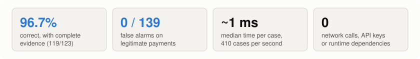
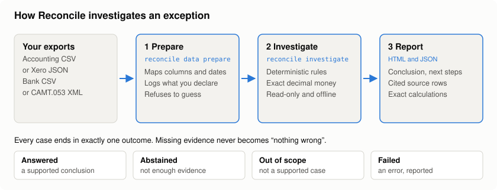
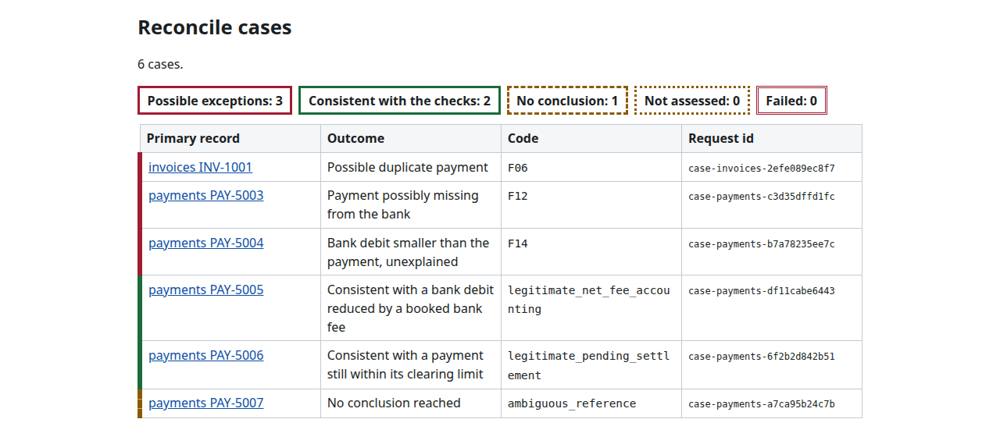
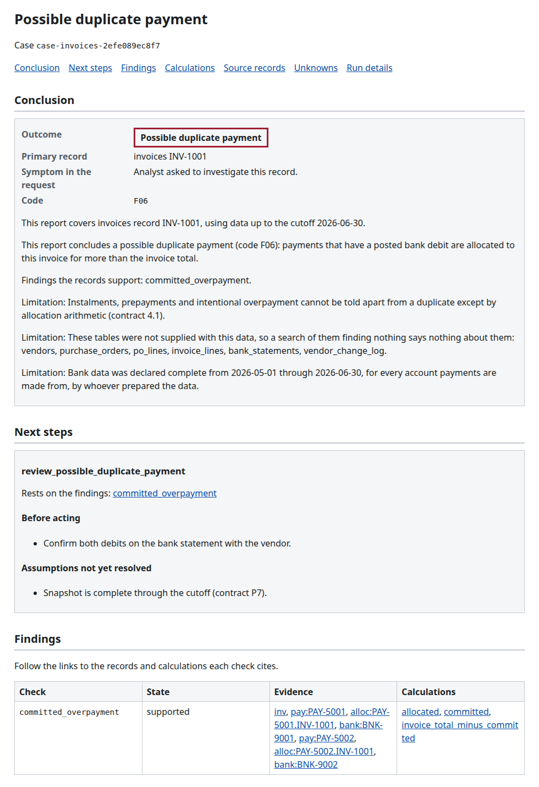
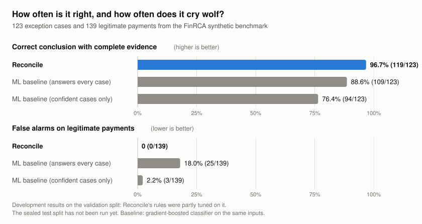

# Reconcile

**Evidence-backed investigation of payment reconciliation exceptions, for finance operations and accounts-payable teams.**

When a payment, an invoice or a bank row doesn't reconcile, Reconcile reads your accounting and bank exports and tells you what happened: a possible duplicate payment, a payment missing from the bank, a bank debit smaller than the payment, or an ordinary case such as a payment still clearing. Every conclusion comes with the exact source rows, the exact arithmetic, what it could not check, and what to do next. When the evidence isn't there, it says so instead of guessing.

It runs locally and offline, is read-only, and has no runtime dependencies. Source-available: free for research and noncommercial use; [commercial use needs a license](#commercial-use).

<picture>
  <source media="(prefers-color-scheme: dark)" srcset="docs/images/highlights-dark.svg">
  
</picture>

## What it does

Reconcile investigates one accounts-payable-to-bank exception at a time, or a whole batch, and writes an HTML and JSON report for each.

| It finds | Code |
|---|---|
| An invoice paid twice (possible duplicate payment) | F06 |
| A payment recorded in accounting but missing from the bank | F12 |
| A bank debit smaller than the payment, with no booked fee to explain it | F14 |

And it recognises ordinary cases that are **not** errors, so they don't become false alarms: a payment still within its clearing window, a debit reduced by a booked bank fee, batch payments, weekend clearing and others.

**Who it is for**
- **Finance operations and AP analysts** who investigate reconciliation breaks by hand today
- **Controllers and auditors** who need every conclusion traceable to source records
- **Developers** building reconciliation tooling, through the Python library and CLI

## How it works

<picture>
  <source media="(prefers-color-scheme: dark)" srcset="docs/images/how-it-works-dark.svg">
  
</picture>

- **Deterministic, not a black box.** Conclusions come from explicit rules over your records, not from a model guess. The same input always gives the same report.
- **Exact money.** Amounts are `Decimal` with an explicit currency, never floating point. Every calculation is shown with its operands.
- **Abstains instead of guessing.** Missing, ambiguous or unsupported evidence ends in `abstained` or `out_of_scope`, never in "nothing wrong".
- **Safe to point at real data.** Read-only: no payment, write-back, database or shell tools. No network, no credentials, no model calls. Output folders are created readable by the owner only.

## What a report looks like

The overview lists every case and its outcome:



Each case page gives the conclusion in plain words, the next steps, the findings with links to the exact source rows, and every calculation:



*Screenshots from `reconcile demo`, which uses an invented company's data shipped with the package.*

## Results

<picture>
  <source media="(prefers-color-scheme: dark)" srcset="docs/images/results-dark.svg">
  
</picture>

| Measure | Reconcile | ML baseline (answers every case) | ML baseline (confident cases only) |
|---|---:|---:|---:|
| Correct and evidence-complete | **119/123 = 96.7%** | 109/123 = 88.6% | 94/123 = 76.4% |
| False alarms on legitimate cases | **0/139** | 25/139 = 18.0% | 3/139 = 2.2% |
| Median time per case | **1.2 ms** | n/a (not comparable) | n/a |

Source: [M3 results card](docs/results-card-m3.md), FinRCA synthetic benchmark, `validation` split. The baseline is a gradient-boosted classifier on the same observable inputs; its "evidence-complete" is a relaxed check that favours it. Paired differences in the first row are +8.1 points (98% interval +3.5 to +15.0) and +20.3 points (+11.1 to +28.7).

**Read these as development results.** Reconcile's rules were partly tuned on this split and the baseline was chosen on it. The sealed comparison hasn't been run, and it could come out differently. Zero false alarms is an observed count, not a guarantee.

## Quick start

Python 3.11 or later on Linux or macOS, with [uv](https://docs.astral.sh/uv/):

```bash
git clone https://github.com/ChRotsides/reconcile.git
cd reconcile
uv build --wheel
uv venv --python 3.12 .venv && uv pip install --python .venv/bin/python dist/reconcile-0.1.0-py3-none-any.whl
.venv/bin/reconcile demo --output demo-out
```

Open `demo-out/report/index.html`. The demo investigates six cases: a possible duplicate payment, a payment possibly missing from the bank, an unexplained short debit, a debit reduced by a booked fee, a payment still within its clearing limit, and one with no conclusion because two payments share a reference.

## How to use it on your own data

**1. Prepare your exports.** Point Reconcile at your data and declare the last day you trust:

```bash
reconcile data prepare --format csv-bundle --source mapping.toml --output prepared --cutoff 2026-06-30
```

| Format | Input |
|---|---|
| `csv-bundle` | Any accounting and bank CSVs, described by a `mapping.toml` (which file holds each table, where each column comes from, declared date formats). See `examples/csv_bundle/`. |
| `xero-camt` | Saved Xero JSON plus CAMT.053 bank statement XML. See `fixtures/xero_camt/config.toml`. |

You also declare what the tool can't see for itself: the period your bank data covers, that every paying account is included, how references should match (`exact` or `normalised`), and whether bank-fee journals are typed. The report repeats these declarations, because its conclusions depend on them. Anything ambiguous, such as a date that matches no declared format, is refused with the file, line and value, never guessed.

**2. Investigate a record:**

```bash
reconcile investigate --snapshot prepared --payment PAY-5004 --output case-1
```

Use `--invoice` or `--bank-transaction` for other record types. It prints the conclusion and writes `report.html`, `packet.json` and a run record.

**3. Or run a batch:**

```bash
reconcile batch --snapshot prepared --records records.csv --output run-1
reconcile report --run run-1 --format html     # or --format json
```

`records.csv` has the header `table,record_id`. Every file in the run is hashed, and `report` refuses a run that was interrupted or altered.

**4. Read the report.** Each case ends in exactly one outcome: `answered`, `abstained` (not enough evidence, never an all-clear), `out_of_scope` or `failed`. Every conclusion cites rows you can find in your own export.

**As a library:**

```python
from datetime import date
from pathlib import Path
from reconcile.diagnosis.pipeline import investigate
from reconcile.domain.contracts import InvestigationRequest, RecordRef

d = "<content_sha256 from prepared/manifest.json>"
request = InvestigationRequest(
    "case-1",
    d,
    RecordRef(d, "payments", "PAY-5004"),
    "Analyst asked to investigate this record.",
    date(2026, 6, 30),
    "evidence-contract-0.5",
)
packet = investigate(Path("prepared/snapshot.sqlite"), request)
```

The full command reference, exit codes and container setup are in the [CLI guide](docs/cli-guide.md).

## Status and limits

- Milestones M0 to M4 have passed their gates; M5 (the usable command-line tool and HTML reports) is built and tested, with 2,141 tests passing. Some gates passed conditionally, because the practitioner reviews they called for haven't happened yet.
- **No practitioner has used it yet, and no real accounting or bank export has been read.** The Xero and CAMT.053 mappings were tested on fixtures and public samples only ([input mapping](docs/input-mapping.md) section 10).
- Whether payment references match between accounting and bank data is unverified, and the checks depend on it. Xero has no approval history, so every all-clear on Xero data abstains. There is no live Xero or bank connection.
- Only payment-related exceptions are supported. Multi-currency (FX) cases abstain. PDF or OCR input, a hosted interface and approvals are not planned for this release ([scope](SCOPE.md)).

**Looking for design partners.** If your team investigates AP-to-bank breaks and would try Reconcile on a real export, a [practitioner walkthrough](docs/practitioner-walkthrough.md) takes about 40 minutes. [Get in touch](#commercial-use).

## Documents

[CLI guide](docs/cli-guide.md) | [Plan](PLAN.md) | [Scope](SCOPE.md) | [Evaluation protocol](docs/evaluation-protocol.md) | [M3 results card](docs/results-card-m3.md) | [M5 results](docs/m5-results.md) | [Decision records](docs/decisions/README.md) | [Practitioner findings](docs/practitioner-findings.md)

## Commercial use

Using Reconcile in a business, including internal use at a bank, payment company, ERP vendor or finance team, needs a commercial license. Pilots, custom mappings for your export formats, and support are available.

Contact **Charalambos Rotsides** at **[lhampis@gmail.com](mailto:lhampis@gmail.com)**.

## License

Reconcile is licensed under the [PolyForm Noncommercial License 1.0.0](LICENSE), which permits research, education, personal and other noncommercial use. It is source-available, not an OSI-approved open-source license. For commercial use, see [Commercial use](#commercial-use).

Copyright 2026 Charalambos Rotsides.
